<picture><source media="(prefers-color-scheme: dark)" srcset="assets/hero-dark.svg"></picture>

<picture><source media="(prefers-color-scheme: dark)" srcset="assets/social-l-dark.svg"></picture><a href="https://www.instagram.com/maz1nx/"><picture><source media="(prefers-color-scheme: dark)" srcset="assets/social-1-dark.svg"></picture></a><a href="https://discord.com/users/276452420719083521"><picture><source media="(prefers-color-scheme: dark)" srcset="assets/social-2-dark.svg"></picture></a><picture><source media="(prefers-color-scheme: dark)" srcset="assets/social-r-dark.svg"></picture>

<picture><source media="(prefers-color-scheme: dark)" srcset="assets/about-dark.svg"></picture>

<a href="https://github.com/iimazin11/i18n-nextjs-15"><picture><source media="(prefers-color-scheme: dark)" srcset="assets/project-i18n-nextjs-15-dark.svg"></picture></a>&nbsp;<a href="https://github.com/iimazin11/haunt-oauth2"><picture><source media="(prefers-color-scheme: dark)" srcset="assets/project-haunt-oauth2-dark.svg"></picture></a>

<a href="https://github.com/iimazin11/totp-otp-auth"><picture><source media="(prefers-color-scheme: dark)" srcset="assets/project-totp-otp-auth-dark.svg"></picture></a>&nbsp;<a href="https://github.com/iimazin11/discord-apis"><picture><source media="(prefers-color-scheme: dark)" srcset="assets/project-discord-apis-dark.svg"></picture></a>

<picture><source media="(prefers-color-scheme: dark)" srcset="assets/stats-dark.svg"></picture>

<picture><source media="(prefers-color-scheme: dark)" srcset="assets/wave-dark.svg"></picture>

